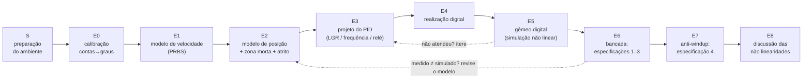

# Projeto Final — Servo de Posição com Motor CC: da Identificação à Malha Fechada Real

**Laboratório de Controle Automático — Engenharia Elétrica — Ifes Campus Guarapari**
**Lançamento:** semana 12 · **Apresentações:** semana 15 · **Bancadas:** duplas (dados em comum) · **Entrega e apresentação:** individuais

---

## 0. Como as últimas semanas vão funcionar

A partir de agora o foco da disciplina é **este projeto**. As aulas passam a ser **de bancada**,
com o professor circulando entre os grupos e com alguns minutos no início para explicar o que a
etapa da semana exige.

A teoria que ainda não vimos juntos (o restante do Módulo 2 e partes do Módulo 4) você vai
**estudar por conta própria, com o apoio do professor**, seguindo o **roteiro de estudo da
Seção 5.1** — ele diz, semana a semana, exatamente quais seções ler, quais laboratórios rodar e o
que você deve saber responder antes de cada aula. O **Módulo 3 (frequência) não é necessário**:
dele, só uma leitura curta sobre margens de ganho e de fase. Todo o material continua no
repositório para consulta.

O projeto **inclui os Trabalhos 1 e 2**, que não serão feitos separadamente: a nota do
**Trabalho 1** (identificação PRBS/FOPDT) é dada no **Marco 1**, a do **Trabalho 2** (PID de
posição) no **Marco 3**, e a do projeto final na apresentação (Seção 5). Como ninguém usou o kit
ainda, a **primeira aula** é de preparação (Etapa S): instalar o ambiente, gravar o firmware e
fazer o primeiro ensaio de ponta a ponta.

## 1. Visão geral

Você vai projetar, implementar e validar um **servo de posição angular**: dado um perfil de
referências em degraus (0° → 90° → −90° → 0°), o eixo do motor deve segui-lo atendendo às
especificações da Seção 4, com o controlador **rodando no Arduino**.



A ideia central do projeto: **um modelo linear bem identificado não basta.** A bancada tem
saturação, zona morta, atrito estático e um encoder de resolução finita. Um controlador que atende
às especificações "no papel" pode falhar feio na bancada — e o seu trabalho é **descobrir por quê,
medir o que faltava no modelo e corrigir o projeto**.

## 2. Organização da turma

- Cada **bancada** (Arduino + ponte H + motor CC + encoder) é usada por uma **dupla**. Os ensaios
  de caracterização da planta (Etapas E0–E2 e o relé da E3) são feitos **juntos** e os CSVs são
  **compartilhados** pela dupla.
- **Projeto, notebook, ensaios em malha fechada, relatório e apresentação são individuais.** Cada
  um apresenta a **sua versão** do controlador, testada na bancada da dupla.
- **Projeto do controlador (Etapa E3):** todos fazem a **Rota A — lugar das raízes** (Módulo 2)
  como rota principal, e a **Rota C — experimento do relé + Ziegler-Nichols** (Módulo 4) como
  verificação, com os dados de relé da bancada. Na dupla, **cada um escolhe as próprias metas de
  projeto** ($\zeta$, $t_s$) — não podem ser iguais — e, na apresentação, vocês comparam os
  resultados: o que a meta mais rápida ganhou (ou perdeu) na bancada?
- **Opcionais (bônus):** a **Rota B — domínio da frequência** (exige estudar o Módulo 3) e o
  **refinamento completo da Rota C** até atender às especificações.
- Na Etapa S (primeira aula), **cada aluno** instala o ambiente no seu computador e grava e coleta pelo menos um ensaio — todos precisam saber operar a bancada.

## 3. Material

### 3.1 Hardware (o kit de sempre — nada a religar)

O kit do laboratório (MOTOR_REV07): Arduino Uno com o shield do display OLED, ponte H
L298N, motor **JGA25-370 de 6 V / 210 rpm** com redução, encoder Hall e a **roda** montada no eixo.

| Ligação | Pino do Arduino |
|---|---|
| L298N IN1 / IN2 (PWM; ENA com jumper) | D9 / D10 (Timer1, 16 bits) |
| encoder C1 / C2 | D2 (interrupção) / D4 |
| OLED SSD1306 (I²C) | A4 / A5 |

Os firmwares do repositório já usam essa pinagem. **Antes de qualquer ensaio:** deixe a roda livre
para girar várias voltas (os ensaios em malha aberta giram o eixo até ≈ 6 voltas) — nada pode
encostar nela.

> **Atenção: o Arduino do kit pode estar com o firmware antigo (MOTOR_REV07) gravado.** Nele,
> quem decide o PWM é um programa no **PC**, que consulta o Arduino pela serial a cada iteração —
> com um atraso de comunicação de dezenas de ms (84 ms no modelo de referência do kit). Neste
> projeto o PID roda **no Arduino**, a cada 20 ms, e o computador só grava a telemetria: grave
> sempre os firmwares do repositório (Etapa S). O encoder passa a contar as duas bordas do canal C1 (≈ 474 contas/volta, contra
> as 237 de antes) e o display só é atualizado antes e depois de cada ensaio.

### 3.2 Software (tudo no repositório)

| Arquivo | O que faz |
|---|---|
| [`firmware/pid_motor/pid_motor.ino`](../firmware/pid_motor/pid_motor.ino) | **firmware do projeto (v2)** — 4 modos de ensaio, PID 2DOF em graus, anti-windup, compensação de zona morta |
| [`firmware/prbs_aquisicao/prbs_aquisicao.ino`](../firmware/prbs_aquisicao/prbs_aquisicao.ino) | PRBS para identificação de velocidade (Trabalho 1) |
| [`firmware/telemetry.py`](../firmware/telemetry.py) | grava a telemetria serial em CSV (`pip install pyserial`) |
| [`projeto_final/ferramentas_projeto.py`](ferramentas_projeto.py) | leitura de CSV, **métricas oficiais**, **simulador idêntico ao firmware** (gêmeo digital), gráficos |
| [`projeto_final/modelo_projeto_final.ipynb`](modelo_projeto_final.ipynb) | **notebook-modelo**: copie, renomeie para `projeto_<seunome>.ipynb` e preencha |

### 3.3 O firmware v2 em 1 minuto

Você só edita os **blocos numerados** no topo do `pid_motor.ino`:

| Bloco | Constante | Para quê |
|---|---|---|
| 2 | `MODO` | 0 = calibração · 1 = malha aberta (degrau de PWM) · 2 = relé · 3 = PID |
| 3 | `CONTAS_POR_GRAU` | medido na Etapa E0 |
| 4 | `kp`, `ki`, `kd`, `N_FILT` | **seu projeto** — em unidades de **graus** ($k_p$ em PWM/grau, $k_i$ em PWM/(grau·s), $k_d$ em PWM·s/grau) |
| 5 | `PWM_MAX`, `AW_MODO`, `TT`, `ZM_COMP`, `E_MORTO` | limitador, anti-windup (0 nenhum, 1 clamping, 2 back-calculation), compensação de zona morta |
| 6 | perfis | degraus do MODO 3; amplitude do MODO 1; parâmetros do relé |

Todos os modos enviam **5 colunas**: `t, r, angle, pwm, u_pid` — tempo [s], referência [graus],
ângulo medido [graus], PWM **aplicado** e $u$ **pedido** pelo controlador antes da saturação (é o
que revela o windup). Para gravar:

```bash
python firmware/telemetry.py --porta COM5 --saida dados/mf_nominal_1.csv --timeout 60
# (Linux: --porta /dev/ttyUSB0)  — depois de iniciar o script, aperte RESET no Arduino
```

O simulador `simula_firmware()` de `ferramentas_projeto.py` executa **as mesmas equações, na
mesma ordem** do firmware, sobre um modelo da planta que você fornece. É o seu **gêmeo digital**:
tudo o que você for testar na bancada, teste antes nele.

## 4. Especificações de desempenho

Para o **degrau de referência de 90°** (0° → 90°, trecho de 5 s do perfil padrão):

1. **Erro de regime** $|e_{ss}| < 2°$ (≈ duas resoluções do encoder);
2. **Sobressinal** $`M_p \le 15\%`$;
3. **Tempo de estabelecimento** $t_s \le 2{,}5$ s (critério de ±5 %, isto é, ±4,5°);
4. **Sem windup visível:** com o PWM saturando durante o degrau, o sobressinal não pode crescer
   mais que **5 pontos percentuais** em relação ao ensaio nominal — com o anti-windup **ligado**; e
   a diferença para o anti-windup **desligado** deve ser mostrada.

As especificações 1–3 devem ser mostradas **em simulação** (modelo identificado) **e na planta
real** (telemetria), e as divergências explicadas. Os outros dois degraus do perfil (90° → −90° e
−90° → 0°) não entram na nota das especificações, mas devem aparecer na tabela de resultados —
eles revelam assimetrias e saturação.

### 4.1 Como as métricas são medidas (vale para todos)

Use **sempre** `metricas_ensaio()` de `ferramentas_projeto.py` — é ela que o professor usa para
conferir. Definições, para um degrau de $r_0$ para $r_1$ ocorrido em $t_0$:

- $`M_p = 100\cdot\max(0,\ \text{pico além de } r_1)/|r_1 - r_0|`$ [%];
- $t_s$ = último instante, contado a partir de $t_0$, em que $|y - r_1| > 0{,}05\,|r_1 - r_0|$;
- $e_{ss}$ = média de $r_1 - y$ no **último 1 s** do trecho;
- `t_sat` = tempo, no trecho, com $|\text{pwm}| \ge$ `PWM_MAX`.

Cada ensaio nominal é feito **3 vezes**; reporte as três e use o **pior caso** para declarar se a
especificação foi atendida (o atrito muda de um ensaio para outro).

### 4.2 Protocolo da especificação 4

O motor desta bancada raramente satura no degrau de 90° com os ganhos típicos — então nós
**forçamos** a saturação, reduzindo o limite do PWM no firmware:

1. ensaio nominal: `PWM_MAX = 255`, `AW_MODO = 1` (já feito para as especificações 1–3);
2. ensaio saturado com proteção: `PWM_MAX = 80`, `AW_MODO = 1` → `mf_sat_aw1.csv`;
3. ensaio saturado **sem** proteção: `PWM_MAX = 80`, `AW_MODO = 0` → `mf_sat_aw0.csv`.

Se na sua bancada o degrau de 90° saturar por menos de 0,3 s com `PWM_MAX = 80`, abaixe o limite
— mas **nunca abaixo de 1,5 × $F_s$** (o PWM de partida medido na Etapa E2), senão o motor mal sai
do lugar. Critério: $M_p(\text{2}) \le M_p(\text{1}) + 5$ p.p.

## 5. Cronograma e marcos

Ajuste as datas ao calendário da turma. **Os marcos são verificados em aula** (o professor passa
na sua bancada): leve o notebook aberto, com os gráficos.

| Semana | Período | Etapas | Marco (o que mostrar ao final da semana) |
|---|---|---|---|
| **P1** — sem. 12 | 09–13/11 | S, E0, E1, E2.1–E2.2 | **M1 — planta identificada (= Trabalho 1):** ambiente funcionando; `CONTAS_POR_GRAU`; FOPDT com desvio $u_0$ e Padé; $K_m$, $F_c^\pm$, $k'$ |
| **P2** — sem. 13 | 16–20/11 ⚠️ 20/11 é feriado | E2.3–E2.4, E3, E4, E5 | **M2 — projeto validado em simulação:** $F_s^\pm$ e gêmeo × malha aberta; Rota A com contas, margens com atraso e filtro, relé + ZN, gêmeo aprovando as especificações 1–3; primeiro ensaio em malha fechada |
| **P3** — sem. 14 | 23–27/11 | E6, E7 | **M3 — bancada (= Trabalho 2):** 3 ensaios nominais + 2 de saturação, tabela medido × simulado, figura do anti-windup |
| **P4** — sem. 15 | 30/11–04/12 | E8, apresentação | **M4 — apresentação individual** + entrega dos arquivos |

### 5.1 Roteiro de estudo (o que estudar por conta própria, semana a semana)

Os laboratórios do Módulo 2 têm **gabarito** no repositório (`labs/gabarito_lab05` a `lab09`):
rode o seu e confira. Os exercícios resolvidos de cada módulo (`exercicios_resolvidos_moduloN.md`)
são a melhor forma de treinar as contas. **Leve as dúvidas para a aula** — os primeiros minutos
de cada aula são para isso. Legenda: ✅ obrigatório · ➕ opcional (bônus ou aprofundamento).

**Semana P1 — para as Etapas E1 e E2** (estude **durante** a semana, junto com a bancada)

| | O que estudar | Onde | Laboratório |
|---|---|---|---|
| ✅ | Modelo de 1ª ordem, ganho e constante de tempo (revisão) | M1 §1.2 | — |
| ✅ | Atraso de transporte e aproximação de Padé | M2 §2.5.4 | Lab 09, Parte 2 |
| ✅ | Não linearidades estáticas: saturação, **zona morta**, histerese | M4 §4.1.1–4.1.6 | Lab 15, Partes 1–3 |
| ✅ | Roteiro do Trabalho 1 (identificação por PRBS) | `trabalhos/trabalho1_…md` | — |

*Antes do Marco 1 você deve saber responder:* o que é $e^{-Ls}$ e por que a Padé tem um zero no
semiplano direito? Por que uma zona morta faz o ajuste "puro" do FOPDT errar o ganho?

**Semana P2 — para as Etapas E3 a E5** (é a semana mais pesada de teoria: **comece já no fim da P1**)

| | O que estudar | Onde | Laboratório |
|---|---|---|---|
| ✅ | Regiões do plano-s: de $M_p$ e $t_s$ para o polo desejado $s_d$; efeito de um zero | M2 §2.1.1–2.1.6 e §2.1.9 | Lab 05, Partes 2 e 4 |
| ✅ | Lugar das raízes: condição de ângulo e de módulo; projeto do ganho | M2 §2.2.1–2.2.5 (§2.2.6–2.2.7: só leitura) | Lab 06, Partes 1–3 |
| ✅ | Avanço de fase e **PD**: contribuição angular, posição do zero, regra dos 40° | M2 §2.3.1–2.3.6 | Lab 07, Partes 1–3 |
| ✅ | Atraso de fase e **PI**: por que o zero perto da origem | M2 §2.4.1–2.4.4 | Lab 08, Partes 1 e 3 |
| ✅ | **PID** pela receita completa; projeto **com atraso de transporte** | M2 §2.5.1, §2.5.3 e §2.5.5 | Lab 09, Partes 1 e 4 |
| ✅ | Margem de ganho e margem de fase (o que o `ct.margin` devolve) e a relação PM × sobressinal | M3 §3.1.8–3.1.9 (**só isso** do Módulo 3) | — |
| ✅ | Experimento do relé e sintonia de Ziegler-Nichols | M4 §4.3.7–4.3.8 | Lab 16, Parte 4 |
| ➕ | Rota B: Bode e PID na frequência | M3 §3.1, §3.4–3.5 | Labs 10, 13, 14 |
| ➕ | Funções descritivas e ciclos-limite (base teórica do relé) | M4 §4.3.1–4.3.6 | Lab 16, Partes 2–3 |

*Antes do Marco 2 você deve saber responder:* dado $s_d$, como se calcula o ângulo que o PD
precisa fornecer — e quanto o atraso tira desse ângulo? De onde sai o ganho? O que significa uma
PM de 50°? Por que o relé faz a malha oscilar com amplitude limitada?

**Semana P3 — para as Etapas E6 e E7**

| | O que estudar | Onde | Laboratório |
|---|---|---|---|
| ✅ | **Windup** e anti-windup (clamping; back-calculation) | M4 §4.2.1–4.2.5 | Lab 16, Parte 1 |
| ✅ | PID real: derivada filtrada ("PID real = PI-Lead") | M2 §2.5.3 (final) | — |
| ➕ | Back-calculation na bancada (bônus) | M4 §4.2.4 | — |

*Antes do Marco 3 você deve saber responder:* por que o integrador "enche" durante a saturação?
O que o clamping faz, em uma frase?

**Semana P4 — para a Etapa E8 e a apresentação**

| | O que estudar | Onde | Laboratório |
|---|---|---|---|
| ✅ | Revisar a §4.1 com os **seus** dados: onde aparece cada não linearidade | M4 §4.1.6 | — |
| ➕ | Ciclo-limite de stick-slip (bônus da E8) | M4 §4.3.1 | — |

## 6. Roteiro detalhado

> Faça tudo no **seu** notebook (cópia do `modelo_projeto_final.ipynb`). Guarde os CSVs numa
> pasta `dados/` ao lado dele, com **exatamente** os nomes indicados em cada etapa.

---

### S — Preparação do ambiente (primeira aula, todos) · *Marco 1*

**Objetivo:** sair da aula conseguindo **gravar um firmware, coletar um ensaio e plotá-lo** no
Python.

1. **Python** (no seu computador ou no do laboratório):
   ```bash
   git clone https://github.com/fabiobento/lab-cont-2026-2.git
   pip install "control==0.10.2" numpy scipy matplotlib jupyter pyserial
   ```
2. **Arduino IDE**: instale também a biblioteca **Adafruit SSD1306** (Gerenciador de Bibliotecas;
   ela traz a Adafruit GFX). No Windows, se a placa não aparecer como porta COM, instale o driver
   **CH340/CH341** (as placas do kit são clones com esse conversor USB-serial).
3. **Primeiro ensaio (teste de sentido):** abra `firmware/pid_motor/pid_motor.ino`, ponha
   `MODO = 1` e `PWM_MA = 100`, grave na placa. Com a roda livre, rode
   ```bash
   python firmware/telemetry.py --porta COM5 --saida dados/teste.csv --timeout 30
   ```
   e aperte RESET no Arduino. A roda deve girar ≈ 2 s e parar.
4. No notebook: `d = carregar_csv("dados/teste.csv")` e plote `d["angle"]` × `d["t"]`. **O ângulo
   tem que crescer** com PWM positivo. Se diminuir, inverta os fios do motor nos bornes OUT1/OUT2
   da L298N (não troque C1/C2) e repita.

**Pronto quando:** você tem um CSV seu, plotado, com o ângulo crescendo. Só então siga para a E0.

---

### E0 — Calibração: contas → graus (MODO 0) · *Marco 1*

**Objetivo:** saber quantas contas do encoder correspondem a 1 grau do eixo de saída.

**Procedimento.**
1. No firmware: `MODO = 0`, `CONTAS_POR_GRAU = 1.0`. Faça uma marca no eixo e outra na carcaça.
2. Inicie o `telemetry.py` (→ `dados/calibracao.csv`), dê RESET e, nos 30 s de ensaio, gire o
   eixo **à mão, devagar, exatamente 5 voltas** no sentido positivo.
3. A 5ª coluna (`u_pid`, neste modo) traz as contas brutas. Calcule

$$\mathrm{CPG} = \frac{\text{contas finais}}{360 \times 5}, \qquad
\text{resolução} = \frac{1}{\mathrm{CPG}}\ \text{graus/conta}, \qquad (\mathrm{CPG} = \texttt{CONTAS\_POR\_GRAU}).$$

4. Grave o valor no bloco 3 do firmware — ele vale para **todos** os ensaios seguintes.

**Armadilhas.** Não reaproveite o `TICKS_PER_REV = 237` do firmware antigo: ele contava só a
subida de C1 (1×); os firmwares v2 contam as duas bordas (2×), então espere **o dobro**. Se as
contas diminuírem ao girar no sentido "positivo", o sentido do encoder está trocado em relação ao
do PWM — confira na Etapa E2.

---

### E1 — Modelo de velocidade por PRBS (= Trabalho 1) · *Marco 1*

**Objetivo:** modelo FOPDT da velocidade, $G_v(s) = \dfrac{Ke^{-Ls}}{\tau s + 1}$, a partir do PRBS.

Esta etapa é o [roteiro do Trabalho 1](../trabalhos/trabalho1_identificacao_prbs_fopdt.md)
(leia os Passos 1–7 de lá), com as adaptações abaixo.

**Procedimento.**
1. Grave `firmware/prbs_aquisicao/prbs_aquisicao.ino` (com o mesmo `CONTAS_POR_GRAU` não há o que
   ajustar: ele mede a velocidade em **contas por janela de 20 ms**). Padrões: PRBS entre PWM
   60 e 220, `Tb_ms = 200` (bit de 200 ms; a constante de tempo esperada é ≈ 0,1 s), `T_ms = 30000`.
2. Colete com `telemetry.py` → `dados/prbs.csv` (colunas `t, u, y`). Se a velocidade não chegar
   a se estabilizar em nenhum bit, aumente `Tb_ms`; se quase não houver trocas, diminua.
3. O Arduino amostra a cada 20 ms; confira que `np.diff(t)` é ≈ 0,02 (se não for, reamostre —
   Passo 3 do T1).
4. Ajuste o FOPDT nas duas versões abaixo e compare; aproxime o atraso por Padé de 1ª e de 10ª
   ordem e compare os três modelos com os dados (Passos 5–6 do T1).
5. Discuta a origem do atraso (Passo 7 do T1).

**O que muda em relação ao roteiro do Trabalho 1 — obrigatório:** o PRBS oscila entre PWM 60 e
220 e **nunca passa por zero**. Como o motor "perde" uma parte do PWM para o atrito, o ajuste
$y = G(s)\,u$ do roteiro do T1 fica **viesado** (o $K$ sai menor do que é). Ajuste também o modelo
com **desvio de entrada**:

$$y = G_v(s)\,(u - u_0), \qquad \text{parâmetros: } K,\ \tau,\ L,\ u_0$$

e compare os dois ajustes (EQM e gráfico). Interprete $u_0$ fisicamente.

```python
from ferramentas_projeto import carregar_csv
prbs = carregar_csv("dados/prbs.csv")      # colunas t, u, y
# ... adapte a função custo(p) do Passo 4 do T1 para p = [K, tau, L, u0] e entrada (u - u0)
```

**Registre:** escolha de `Tb_ms` (e por quê); $K$, $\tau$, $L$, $u_0$; EQM das duas versões e dos
modelos com Padé; gráfico medido × modelos; a sua discussão da origem do atraso (o que, nesse
$L$, existe na malha de **posição**?).

**Consulte:** roteiro do Trabalho 1; teoria M1 §1.2; M2 §2.5.4 (Padé); M4 §4.1.4 (zona morta); Lab 09.

---

### E2 — Modelo de posição, zona morta e atrito estático (MODO 1) · *Marcos 1 e 2*

**Objetivo:** o modelo que o controlador realmente enxerga,

$$G_p(s) = \frac{\Theta(s)}{U(s)} = \frac{K_m}{s(\tau s + 1)}\,e^{-Ls} \qquad [\text{graus}/\text{PWM}],$$

e as **não linearidades** da bancada.

**E2.1 — Inclinações (4 ensaios).** `MODO = 1`, `PWM_MA` = **+100, +200, −100, −200** (o degrau
começa em 0,5 s e dura 2 s). Arquivos: `dados/ma_p100.csv`, `ma_p200.csv`, `ma_m100.csv`,
`ma_m200.csv`. Em cada um, ajuste uma reta ao ângulo no trecho de regime (de 1,5 s a 2,5 s):
inclinação $a(A)$ em graus/s. Com a zona morta, $a(A) = K_m\,(A - F_c)$ para $A > 0$. Então

$$K_m = \frac{a(200) - a(100)}{200 - 100}, \qquad F_c = 100 - \frac{a(100)}{K_m}$$

e o mesmo no sentido negativo ($F_c^-$). Compare $K_m^+$ com $K_m^-$ e $F_c^+$ com $F_c^-$.

> Por que duas amplitudes? O roteiro antigo usava uma só, $k' = a/(KA)$. Com $A = 150$ e uma zona
> morta de ≈ 40 PWM, isso erra o ganho em quase 30 %.

**E2.2 — Ligação com a Etapa E1.** Calcule $k' = K_m/K$ e compare com o valor teórico
$k'_{teo} = 1/(T_s \cdot \mathrm{CPG})$ — por quê? Diferenças de alguns % são normais;
diferenças grandes indicam erro no $K$ da E1 ou na calibração.

**E2.3 — Atrito estático (teste de partida).** `MODO = 1` com `PWM_MA` = 30, 32, 34, … até o eixo
**sair do repouso**; anote o menor valor ($F_s^+$). Repita com valores negativos ($F_s^-$).
Compare com $F_c$: se $F_s > F_c$, há **atrito estático** ("o motor precisa de mais para começar
do que para continuar") — guarde essa informação, ela explica fenômenos das Etapas E5 e E8.

**E2.4 — Gêmeo digital e validação.** Monte o dicionário do gêmeo e confira que ele reproduz os
ensaios de malha aberta:

```python
from ferramentas_projeto import simula_firmware, carregar_csv
GEMEO = dict(Km=..., tau=..., L=..., Fc=..., Fc_neg=..., Fs=..., Fs_neg=..., cpg=CONTAS_POR_GRAU)
sim = simula_firmware(GEMEO, modo="malha_aberta", pwm_ma=100, ma_ini=0.5, ma_fim=2.5)
med = carregar_csv("dados/ma_p100.csv")
# sobreponha sim["angle"] e med["angle"] em função do tempo
```

**Registre (E2.1–E2.2 no Marco 1; E2.3–E2.4 no Marco 2):** tabela com CPG, $K$, $\tau$, $L$, $u_0$, $K_m^\pm$, $F_c^\pm$, $F_s^\pm$,
$k'$ × $k'_{teo}$; gráfico gêmeo × medido em pelo menos dois ensaios.

**Consulte:** teoria M4 §4.1 (saturação, zona morta, atrito); Lab 15.

---

### E3 — Projeto do controlador · *Marco 2*

**Estrutura do controlador** (a do firmware): PID com **2 graus de liberdade** — P e I sobre o
erro, D **filtrado** sobre a **medição**:

$$u = k_p\,e + k_i\!\int e\,dt - k_d\,\frac{N s}{s + N}\,y .$$

Para análise, use

$$C_y(s) = k_p + \frac{k_i}{s} + k_d\frac{Ns}{s+N}, \qquad
\underbrace{C_y(s)\,G_p(s)}_{\text{margens}}, \qquad
T(s) = \frac{G_p(s)\,(k_p + k_i/s)}{1 + G_p(s)\,C_y(s)} \ \ (\text{resposta a } r).$$

**O atraso entra no projeto.** Use $L_{ef} = L + T_s/2$ (o segurador de ordem zero do PWM custa
meio período) e aproxime $e^{-L_{ef}s}$ por Padé (`ct.pade(L_ef, 3)`) nas análises. O filtro da
derivada ($N$, Etapa E4) também tira fase — inclua-o.

```python
import control as ct
s = ct.tf("s")
G  = Km / (s * (tau * s + 1))
Pd = ct.tf(*ct.pade(L + 0.02/2, 3))
Cy = kp + ki/s + kd*N*s/(s + N)
gm, pm, wg, wc = ct.margin(Cy * G * Pd)
T  = ct.feedback(G * Pd, Cy) * (kp + ki/s)
t, y = ct.step_response(90 * T, np.linspace(0, 5, 2001))
```

> **O que estudar para esta etapa:** Seção 5.1, semana P2. Do Módulo 3, só as margens
> (M3 §3.1.8–3.1.9): o `ct.margin` devolve a margem de ganho e a de fase da malha; use-as como
> **indicador de robustez** (PM entre 45° e 60° é uma boa faixa).

#### Iteração 1 (todos): projete para a especificação

Faça um primeiro projeto, pela Rota A, que atenda às especificações 2 e 3 **com uma
folga modesta** (por exemplo, $`M_p ≈ 10\,\%`$ e $t_s$ entre 1 e 2 s no modelo linear). Simule no
modelo linear **e** no gêmeo digital (Etapa E5). **Se não atender no gêmeo, não descarte:** ela
entra no relatório como iteração 1, com o diagnóstico. Uma conta útil para o diagnóstico: parado,
o motor só volta a andar quando $|u| > F_s$; quanto vale o erro $F_s/k_p$ para os seus ganhos?

#### Rota A — Lugar das raízes (plano-s) — obrigatória, rota principal de todos

Siga a "receita de bolo" da teoria **M2 §2.5.1** com o PID $C(s) = k_d\dfrac{(s+a)(s+z)}{s}$.
Se, no passo 2, $\angle G_p(s_d) > -180°$, **não há avanço a fornecer**: o controlador é só um PI,
$C(s) = k\,(s+z)/s$, com $k$ pela condição de módulo (é o que costuma acontecer na iteração 1).

1. escolha $\zeta$ e $\sigma$ (ou $t_s$) → polo desejado $s_d$;
2. calcule $\angle G_p(s_d)$ **incluindo o atraso**: $\angle e^{-L_{ef}s_d} = -\omega_d L_{ef}$ (M2 §2.5.5);
3. avanço necessário → zero do PD ($a$); ganho pela condição de módulo ($k_d$);
4. zero do PI ($z$) — justifique a escolha (M2 §2.4: "1/10 da parte real" é o chute inicial;
   pense no que o atrito pede do integrador);
5. converta: $k_p = k_d(a+z)$, $k_i = k_d\,a\,z$; simule; ajuste $\zeta$, $\sigma$, $z$ se preciso.

Mostre o LGR com $s_d$ marcado e as contas do passo 2–3 **à mão** (pode conferir no Python).

#### Rota B — Domínio da frequência — ➕ opcional (bônus; exige o Módulo 3)

Siga a teoria **M3 §3.5.4** (PID na frequência):

1. escolha a frequência de cruzamento $\omega_c$ e a margem de fase PM;
2. calcule a fase de $G_p(j\omega_c)e^{-j\omega_cL_{ef}}$, a fase que o PI (zero em $z_i$) e o filtro
   ($N$) tiram em $\omega_c$, e a fase que o PD precisa fornecer → $T_d$;
3. ajuste o ganho para $|C(j\omega_c)G_p(j\omega_c)| = 1$;
4. converta a forma série $K(1+T_ds)(1+z_i/s)$ para $k_p, k_i, k_d$; confira as margens com
   `ct.margin` (as fórmulas de cruzamento são aproximadas — **confira sempre**).

Mostre o diagrama de Bode da malha com as margens.

#### Rota C — Experimento do relé — obrigatória como verificação (refinamento ➕ opcional)

`MODO = 2` (relé $d$ = `D_RELE` = 120 PWM, histerese `H_RELE` = 1°, em torno de 0°) →
`dados/rele.csv`. Descarte os 2 primeiros segundos, meça a semi-amplitude $a$ e o período $P_u$, e
calcule (teoria **M4 §4.3.7–4.3.8**, Lab 16 Parte 4)

$$K_u = \frac{4d}{\pi\sqrt{a^2 - h^2}}, \qquad \text{ZN-PID: } k_p = 0{,}6K_u,\ T_i = P_u/2,\ T_d = P_u/8 .$$

Calcule as margens do ZN puro no seu modelo e simule o degrau: o que acontece? Compare os ganhos
do ZN com os da sua Rota A. *Opcional (bônus):* proponha e **justifique** um refinamento do ZN
(Lab 16, Parte 4) até atender às especificações e compare-o com a sua Rota A.

**Registre (Marco 2):** contas da Rota A (iteração 1 e final); tabela comparando iteração 1,
Rota A final e ZN do relé (ganhos, GM, PM, $\omega_c$, $M_p$ e $t_s$ lineares); LGR com $s_d$
marcado; degraus simulados. (Se fez a Rota B: Bode com as margens.)

---

### E4 — Realização digital · *Marco 2*

Justifique, com números:

- **período de amostragem** $T_s$ = 20 ms frente à frequência de cruzamento $\omega_c$ que o
  `ct.margin` devolveu (regra usual: $\omega_s = 2\pi/T_s$ entre 10 e 30 vezes $\omega_c$). O ZOH
  equivale a um atraso de $T_s/2$ — você já o incluiu em $L_{ef}$. Teste: simule o seu controlador
  com o atraso de **84 ms** de um laço que rodasse no PC (como no firmware antigo do kit) — basta
  trocar `L` no modelo. O seu projeto continuaria funcionando?;
- **filtro da derivada** $N$ [rad/s]: o firmware discretiza por Euler,
  $x_f[k+1] = x_f[k] + T_sN(-y[k] - x_f[k])$ — o que acontece com $N T_s = 1$? E com $N T_s > 2$?
  Quanto ruído de PWM uma única conta de encoder gera no termo derivativo com o seu $k_d$ e $N$?
  Qual o efeito de $N$ na sua resposta simulada (teste $N$ = 10, 30 e 50)?;
- **equações de recorrência** que o firmware executa (leia o `pid_motor.ino` e escreva-as);
- **conferência**: compare o degrau do controlador contínuo com o do firmware simulado
  (`simula_firmware` sobre o modelo **linear**, isto é, sem `Fc`, `Fs` e `cpg`).

Use `linhas_firmware(kp, ki, kd, N)` para gerar as linhas do bloco 4.

**Consulte:** M2 §2.5.3 (PID real = PI-Lead); M4 §4.2.5.

---

### E5 — Gêmeo digital: atrito, compensação e robustez · *Marco 2*

Rode o seu controlador no **gêmeo** (o perfil completo de 17 s) e meça as especificações:

```python
from ferramentas_projeto import simula_firmware, metricas_ensaio, imprime_metricas, plota_ensaio
ctrl = dict(kp=..., ki=..., kd=..., N=..., pwm_max=255, aw=1, zm_comp=0, e_morto=0.0)
sim = simula_firmware(GEMEO, ctrl)
imprime_metricas(metricas_ensaio(sim))
plota_ensaio(sim, titulo="gêmeo digital")
```

Se o erro de regime ou o $t_s$ não atenderem, você tem três ferramentas (teoria **M4 §4.1**):

1. **mais banda** (volte à E3 com metas mais rápidas) — reduz $F_s/k_p$;
2. **compensação da zona morta** (`ZM_COMP` ≈ um pouco abaixo de $F_c$): o firmware soma
   ±`ZM_COMP` ao comando, "cancelando" a zona morta;
3. **faixa sem compensação** (`E_MORTO`, em graus): perto da referência, só o PID atua.

Teste **separadamente** cada uma e explique o que muda (olhe também o **PWM**: o que acontece com
`ZM_COMP` e `E_MORTO = 0` depois que o eixo para?).

**Robustez (obrigatório).** O atrito real muda de um ensaio para outro. Repita a simulação para
**pelo menos 20 plantas** com $F_c$, $F_s$ (nos dois sentidos) sorteados em ±15 % e conte em quantas
as especificações 1–3 são atendidas nos três degraus. Compare pelo menos: (a) sem compensação,
(b) a sua configuração final, (c) a final com um $k_i$ bem maior. Qual a conclusão sobre o
integrador?

**Registre (Marco 2):** tabela das configurações testadas no gêmeo, taxa de aprovação na
robustez, e os valores finais para o firmware (`kp`, `ki`, `kd`, `N_FILT`, `ZM_COMP`, `E_MORTO`).

---

### E6 — Validação na bancada: especificações 1–3 (MODO 3) · *Marco 3*

1. Programe os valores finais, `PWM_MAX = 255`, `AW_MODO = 1`.
2. **Antes do primeiro ensaio:** com a roda livre, confira o sentido (se o motor disparar girando
   sem parar, a realimentação está positiva — desligue e inverta os fios do motor nos bornes
   OUT1/OUT2 da L298N; não troque C1/C2, porque C1 precisa ficar no D2).
3. Execute o perfil padrão **3 vezes** → `dados/mf_nominal_1.csv`, `_2.csv`, `_3.csv`.
4. Tabela das métricas dos 3 degraus × 3 repetições (`imprime_metricas`) e a **mesma tabela do
   gêmeo**; gráfico gêmeo × bancada (`plota_ensaio(sim, med, rotulos=[...])`).
5. Discuta as diferenças medido × simulado (linear **e** gêmeo): sobressinal, $t_s$, erro de
   regime, assimetria entre os degraus positivo e negativo, dispersão entre repetições.

Se uma especificação falhar na bancada, **diagnostique antes de mexer nos ganhos**: o gêmeo previa
a falha? Se não, o que falta no modelo? Volte à E2/E5 e documente a iteração.

---

### E7 — Especificação 4: saturação e anti-windup · *Marco 3*

Siga o protocolo da Seção 4.2 (`mf_sat_aw1.csv`, `mf_sat_aw0.csv`). Faça o mesmo no gêmeo.
Mostre, para o degrau de 90° **e** para o de 180°:

- ângulo com e sem anti-windup;
- `pwm` (aplicado) e `u_pid` (pedido) com e sem anti-windup — aponte, no gráfico, o intervalo em
  que o clamping congela o integrador e o momento em que a carga do integrador "cobra seu preço";
- a tabela $M_p$, $t_s$, $e_{ss}$, `t_sat` dos três ensaios (nominal, AW ligado, AW desligado) e o
  veredito da especificação 4.

*Opcional (bônus na rubrica):* repita com `AW_MODO = 2` (back-calculation) e compare (escolha de
`TT`: teoria M4 §4.2.4).

**Consulte:** M4 §4.2; Lab 16 Parte 1.

---

### E8 — Discussão das não linearidades · *apresentação*

Monte uma tabela "**onde cada não linearidade aparece nos seus dados** e como foi tratada":
saturação do PWM, zona morta/atrito de Coulomb, atrito estático, quantização do encoder, atraso.
Cite o gráfico/número de cada evidência.

*Opcional (bônus):* **ciclo-limite de stick-slip.** No gêmeo e, se der tempo, na bancada: perfil
`{0, 90}` com troca em 1 s, 40 s de ensaio, `ZM_COMP = 0` e $k_i$ grande (4 a 8× o seu). Meça
amplitude e período da oscilação e explique o mecanismo (teoria M4 §4.3.1).

## 7. Entregáveis

**Até o dia da sua apresentação**, um `.zip` individual (`projeto_<seunome>.zip`) contendo:

```
projeto_<seunome>/
├── projeto_<seunome>.ipynb     ← notebook EXECUTADO (todas as saídas visíveis)
├── apresentacao.pdf            ← slides
├── pid_motor.ino               ← o firmware exatamente como foi usado nos ensaios finais
└── dados/
    ├── calibracao.csv  prbs.csv  rele.csv
    ├── ma_p100.csv  ma_p200.csv  ma_m100.csv  ma_m200.csv
    ├── mf_nominal_1.csv  mf_nominal_2.csv  mf_nominal_3.csv
    ├── mf_sat_aw1.csv  mf_sat_aw0.csv
    └── (opcionais: mf_iter1.csv, mf_longo_ki_alto.csv, mf_sat_aw2.csv)
```

Os CSVs das Etapas E0–E3 são os mesmos para os dois integrantes da bancada; os de malha fechada
são **seus** (com os **seus** ganhos).

### 7.1 O notebook (é o relatório)

Use o `modelo_projeto_final.ipynb`: as seções já estão na ordem certa. Cada seção termina com
uma célula de texto **"Discussão"** com as suas conclusões — gráfico sem interpretação não pontua.

### 7.2 A apresentação (≈ 8 min + 4 min de arguição)

Roteiro sugerido de slides:

1. a bancada e o modelo identificado (tabela da E2 + um gráfico gêmeo × malha aberta);
2. iteração 1: o que deu errado e por quê (a conta $F_s/k_p$);
3. o seu projeto final: metas, contas principais da Rota A, LGR com $s_d$, margens;
4. comparação com o projeto do colega de bancada (outras metas) e com o ZN do relé;
5. bancada: gráfico do degrau + tabela medido × simulado (pior de 3);
6. anti-windup: a figura com `u_pid` × `pwm` (especificação 4);
7. tabela das não linearidades;
8. conclusão: o que faria diferente; limitações do modelo.

Na arguição, espere perguntas sobre **os seus próprios gráficos e números**.

## 8. Avaliação

| Critério | Peso | Excelente | Suficiente | Insuficiente |
|---|---|---|---|---|
| Identificação e modelo | 20 % | FOPDT com $u_0$; $K_m$ com 2 amplitudes; $F_c^\pm$, $F_s^\pm$; gêmeo validado | FOPDT e $K_m$ coerentes, sem as não linearidades | modelo sem validação ou com unidades erradas |
| Projeto do controlador | 25 % | contas da Rota A com atraso e filtro, margens, comparação com o relé e com o colega, iterações justificadas | Rota A com contas e margens | ganhos por tentativa e erro, sem justificativa |
| Especificações na planta real | 30 % | 1–3 atendidas nas 3 repetições; medido × simulado discutido | 1–3 atendidas no degrau de 90° | alguma falha sem diagnóstico |
| Anti-windup e não linearidades | 15 % | especificação 4 com AW ligado × desligado, `u_pid` × `pwm`, tabela de não linearidades | especificação 4 demonstrada | sem ensaio de saturação |
| Apresentação e arguição | 10 % | domina os próprios dados | responde parcialmente | não domina o próprio trabalho |

**Bônus (até +10 %, sem ultrapassar a nota máxima):** Rota B (frequência) comparada à Rota A;
refinamento completo do ZN; back-calculation comparado ao clamping; ciclo-limite de stick-slip
medido e explicado.

**Trabalho 1:** avaliado no **Marco 1**, com os critérios do
[enunciado do Trabalho 1](../trabalhos/trabalho1_identificacao_prbs_fopdt.md) (Seção 4) aplicados aos
itens S + E0 + E1 + E2.1–E2.2 entregues até lá.

**Trabalho 2:** avaliado no **Marco 3**, com os critérios do
[enunciado do Trabalho 2](../trabalhos/trabalho3_pid_posicao_motor_cc.md) (Seção 4) aplicados aos itens
E2 + E3 + E6 + E7 entregues até lá.

## 9. Problemas frequentes na bancada

| Sintoma | Causa provável | O que fazer |
|---|---|---|
| motor dispara girando sem parar no MODO 3 | realimentação positiva (sentido do encoder × PWM) | desligue; no MODO 1 com PWM > 0 o ângulo deve **crescer**; senão inverta os fios do motor em OUT1/OUT2 |
| 90° de referência viram ≈ 45° ou 180° | `CONTAS_POR_GRAU` errado (ex.: o 237 do firmware MOTOR_REV07, que contava 1×) | refaça a E0 |
| erro de compilação na `Adafruit_SSD1306` | biblioteca do display não instalada | instale-a (Gerenciador de Bibliotecas) ou ponha `#define USAR_OLED 0` |
| motor não se mexe com os "seus" ganhos | ganhos pequenos frente à zona morta ($k_p\cdot e < F_s$) | E5 |
| erro de regime de vários graus | atrito/zona morta | E5: banda, `ZM_COMP`, `E_MORTO` |
| oscilação lenta (vários segundos) em torno da referência | integrador forte + atrito estático (stick-slip) | reduza $k_i$; E8 |
| zumbido / PWM trepidando com o eixo parado | `ZM_COMP` sem `E_MORTO`, ou $N$ alto | E4/E5 |
| oscilação rápida que cresce | margem de fase insuficiente (atraso/filtro esquecidos) | refaça as margens com $L_{ef}$ e $N$ |
| CSV vazio ou cortado | RESET antes do `telemetry.py`; `--timeout` curto | inicie o script, **depois** RESET; `--timeout 60` |
| windup "não aparece" | saturação curta demais | Seção 4.2 |

## 10. Mapa de consulta

(Detalhe semana a semana na Seção 5.1.)

| Assunto | Teoria | Laboratório | Para o projeto |
|---|---|---|---|
| modelos de 1ª ordem, identificação | M1 §1.2; roteiro do Trabalho 1 | Lab 02 | ✅ |
| atraso de transporte, Padé | M2 §2.5.4–2.5.5 | Lab 09 | ✅ |
| regiões do plano-s, lugar das raízes, PD/PI/PID | M2 §2.1–2.5 | Labs 05–09 | ✅ |
| margens de ganho e de fase | M3 §3.1.8–3.1.9 | — | ✅ (só isso do M3) |
| Bode, Nichols, Nyquist | M3 §3.1–3.3 | Labs 10–12 | ➕ |
| PD/PI/PID na frequência (Rota B) | M3 §3.4–3.5 | Labs 13–14 | ➕ |
| saturação, zona morta, atrito | M4 §4.1 | Lab 15 | ✅ |
| windup e anti-windup | M4 §4.2 | Lab 16, Parte 1 | ✅ |
| relé e Ziegler-Nichols | M4 §4.3.7–4.3.8 | Lab 16, Parte 4 | ✅ |
| funções descritivas, ciclos-limite | M4 §4.3.1–4.3.6 | Lab 16, Partes 2–3 | ➕ |

**Bom projeto!**
